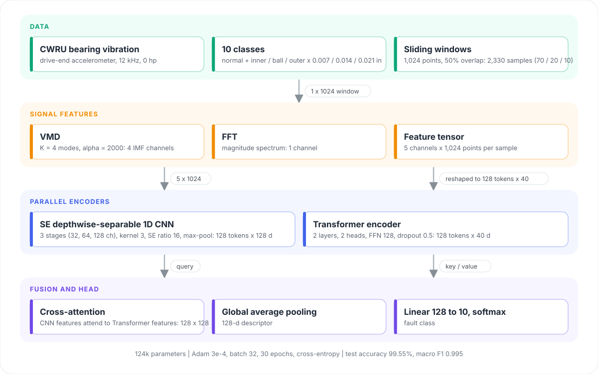

<div align="center">

<picture>
  <source media="(prefers-color-scheme: dark)" srcset="docs/assets/logo-dark.svg">
  
</picture>

<p><strong>Bearing fault diagnosis with a parallel SE-depthwise-separable CNN and Transformer</strong></p>

<p>
  <a href="https://ieeexplore.ieee.org/document/11117663"></a>
  <a href="https://ieeexplore.ieee.org/document/11117663"></a>
  <a href="LICENSE"></a>
  
  
  
  <a href="https://github.com/Erikdai"></a>
</p>

<p><strong>English</strong> | <a href="README.zh-CN.md">简体中文</a></p>

</div>

## Overview

SEDSCN-Trans is the PyTorch implementation of the model proposed in *Fault Diagnosis of Aero-engine Inter-shaft Bearings Using a Parallel SE-Depthwise Separable Convolutional Neural Network and Transformer Model* (IEEE MCTE 2024). A vibration window is decomposed into VMD modes and an FFT spectrum, encoded by two branches in parallel, fused with cross-attention and classified into ten bearing conditions.

- **Signal features**: variational mode decomposition (K = 4) plus the FFT magnitude spectrum, giving a 5 x 1024 tensor per window.
- **Parallel encoders**: a squeeze-and-excitation depthwise-separable 1D CNN for local patterns in the modes and spectrum, and a Transformer encoder for long-range dependencies in the raw window.
- **Cross-attention fusion**: the CNN features act as queries over the Transformer features, followed by global average pooling and a linear classifier.
- **Lightweight**: 124k parameters; the reference run trains 30 epochs in under a minute on one GPU.

The notebooks reproduce the experiment on the public Case Western Reserve University (CWRU) bearing dataset (12 kHz drive-end, 0 hp): normal plus inner-race, ball and outer-race faults of 0.007, 0.014 and 0.021 inch.

| Test set (224 windows) | Value |
| --- | --- |
| Accuracy | 99.55% |
| Macro F1 | 0.995 |
| Parameters | 124,270 |

## Architecture

<p align="center">
  
</p>

| Stage | Setting |
| --- | --- |
| Windowing | 1,024 points, 50% overlap, 233 windows per class, split 70 / 20 / 10 |
| VMD | K = 4, alpha = 2000, tau = 0, tol = 1e-7 (`vmdpy`) |
| CNN branch | stages (1 x 32, 3 x 64, 3 x 128), kernel 3, SE reduction 16, max-pool after each stage |
| Transformer branch | input folded into 128 tokens x 40, 2 layers, 2 heads, FFN 128, dropout 0.5 |
| Fusion and head | cross-attention (query = CNN, key / value = Transformer), global average pooling, linear 128 to 10 |
| Training | Adam 3e-4, batch 32, 30 epochs, cross-entropy, seed 100 |

## How to run

```bash
git clone https://github.com/Erikdai/Fault-Diagnosis-of-Aero-engine-Inter-shaft-Bearings.git
cd Fault-Diagnosis-of-Aero-engine-Inter-shaft-Bearings
pip install -r requirements.txt
jupyter lab
```

Run the notebooks in this order. Each one saves its outputs with `joblib` for the next step.

| Step | Notebook | What it does |
| --- | --- | --- |
| 1 | `create_dataset_1.ipynb` | Reads the ten `.mat` files in `crwu_dataset/`, cuts every class into 1,024-point windows and saves the train / validation / test tensors |
| 2 | `create_dataset_2.ipynb` | VMD + FFT features for every window (5 x 1024). VMD runs per window, so this step takes a few minutes |
| 3 | `SEDSCN-TRANS.ipynb` | Builds the model, trains for 30 epochs, keeps the best checkpoint and reports accuracy, per-class metrics and the confusion matrix |

`preprocessing_FFT.ipynb` and `preprocessing_VMD.ipynb` are exploratory: they plot the raw signals, their spectra and VMD modes, and show how K = 4 was chosen from the centre frequencies.

The CWRU recordings are included. File names encode the fault diameter in mil and the fault type.

| File | CWRU record | Condition |
| --- | --- | --- |
| `0_0.mat` | 97 | normal |
| `7_1` / `7_2` / `7_3` | 105 / 118 / 130 | inner race / ball / outer race, 0.007 in |
| `14_1` / `14_2` / `14_3` | 169 / 185 / 197 | inner race / ball / outer race, 0.014 in |
| `21_1` / `21_2` / `21_3` | 209 / 222 / 234 | inner race / ball / outer race, 0.021 in |

## Project structure

```
SEDSCN-TRANS.ipynb        model, training and evaluation
create_dataset_1.ipynb    .mat recordings to windowed tensors
create_dataset_2.ipynb    VMD + FFT features
preprocessing_FFT.ipynb   FFT exploration
preprocessing_VMD.ipynb   VMD exploration and the choice of K
crwu_dataset/             CWRU drive-end recordings, 10 classes
docs/assets/              logo and architecture figure
```

## Citation

If you use this code or model, please cite the paper:

```bibtex
@inproceedings{dai2024sedscntrans,
  title     = {Fault Diagnosis of Aero-Engine Inter-Shaft Bearings Using a Parallel {SE}-Depthwise Separable Convolutional Neural Network and Transformer Model},
  author    = {Dai, Chengxiao and Su, Guyun and Li, Xiaotong},
  booktitle = {2024 7th International Conference on Mechatronics and Computer Technology Engineering (MCTE)},
  pages     = {304--308},
  year      = {2024},
  publisher = {IEEE},
  doi       = {10.1109/MCTE62505.2024.11117663},
  url       = {https://ieeexplore.ieee.org/document/11117663}
}
```

## Author

Chengxiao Dai ([@Erikdai](https://github.com/Erikdai)), with co-authors Guyun Su and Xiaotong Li.

## License

[MIT](LICENSE). The bearing recordings belong to the Case Western Reserve University Bearing Data Center.
