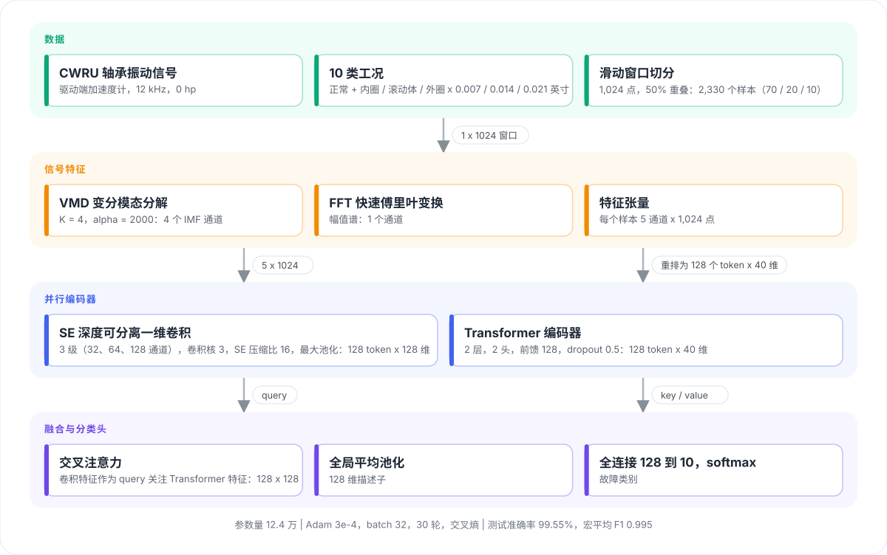

<div align="center">

<picture>
  <source media="(prefers-color-scheme: dark)" srcset="docs/assets/logo-dark.svg">
  
</picture>

<p><strong>并行 SE 深度可分离卷积 + Transformer 的轴承故障诊断</strong></p>

<p>
  <a href="https://ieeexplore.ieee.org/document/11117663"></a>
  <a href="https://ieeexplore.ieee.org/document/11117663"></a>
  <a href="LICENSE"></a>
  
  
  
  <a href="https://github.com/Erikdai"></a>
</p>

<p><a href="README.md">English</a> | <strong>简体中文</strong></p>

</div>

## 项目简介

SEDSCN-Trans 是论文《Fault Diagnosis of Aero-engine Inter-shaft Bearings Using a Parallel SE-Depthwise Separable Convolutional Neural Network and Transformer Model》（IEEE MCTE 2024）所提模型的 PyTorch 实现。每个振动窗口先分解为 VMD 模态和 FFT 频谱，再由两条支路并行编码，经交叉注意力融合后分为十类轴承状态。

- **信号特征**：变分模态分解（K = 4）加 FFT 幅值谱，每个窗口得到 5 x 1024 的特征张量。
- **并行编码器**：SE 深度可分离一维卷积网络提取模态与频谱中的局部特征，Transformer 编码器捕捉原始窗口中的长程依赖。
- **交叉注意力融合**：卷积特征作为 query 关注 Transformer 特征，再经全局平均池化和线性层分类。
- **轻量**：参数量 12.4 万，参考实验在单卡上 30 轮训练不到一分钟。

仓库中的 notebook 在公开的凯斯西储大学（CWRU）轴承数据集上复现实验（12 kHz 驱动端，0 hp）：正常状态加上 0.007、0.014、0.021 英寸的内圈、滚动体、外圈故障。

| 测试集（224 个窗口） | 数值 |
| --- | --- |
| 准确率 | 99.55% |
| 宏平均 F1 | 0.995 |
| 参数量 | 124,270 |

## 架构

<p align="center">
  
</p>

| 阶段 | 设置 |
| --- | --- |
| 窗口切分 | 1,024 点，50% 重叠，每类 233 个窗口，按 70 / 20 / 10 划分 |
| VMD | K = 4，alpha = 2000，tau = 0，tol = 1e-7（`vmdpy`） |
| 卷积支路 | 三级（1 x 32、3 x 64、3 x 128），卷积核 3，SE 压缩比 16，每级后接最大池化 |
| Transformer 支路 | 输入重排为 128 个 token x 40 维，2 层，2 头，前馈 128，dropout 0.5 |
| 融合与分类头 | 交叉注意力（query = 卷积特征，key / value = Transformer 特征），全局平均池化，线性层 128 到 10 |
| 训练 | Adam 3e-4，batch 32，30 轮，交叉熵，随机种子 100 |

## 如何运行

```bash
git clone https://github.com/Erikdai/Fault-Diagnosis-of-Aero-engine-Inter-shaft-Bearings.git
cd Fault-Diagnosis-of-Aero-engine-Inter-shaft-Bearings
pip install -r requirements.txt
jupyter lab
```

按下面的顺序运行 notebook，每一步的输出用 `joblib` 保存给下一步使用。

| 步骤 | Notebook | 作用 |
| --- | --- | --- |
| 1 | `create_dataset_1.ipynb` | 读取 `crwu_dataset/` 中的十个 `.mat` 文件，把每一类切成 1,024 点的窗口，保存训练 / 验证 / 测试张量 |
| 2 | `create_dataset_2.ipynb` | 对每个窗口做 VMD + FFT 特征提取（5 x 1024）。VMD 逐窗口计算，这一步需要几分钟 |
| 3 | `SEDSCN-TRANS.ipynb` | 构建模型，训练 30 轮，保留最优权重，输出准确率、各类指标和混淆矩阵 |

`preprocessing_FFT.ipynb` 和 `preprocessing_VMD.ipynb` 是探索性 notebook：绘制原始信号、频谱和 VMD 模态，并展示如何根据中心频率选定 K = 4。

CWRU 数据已包含在仓库中。文件名由故障直径（mil）和故障类型组成。

| 文件 | CWRU 编号 | 工况 |
| --- | --- | --- |
| `0_0.mat` | 97 | 正常 |
| `7_1` / `7_2` / `7_3` | 105 / 118 / 130 | 内圈 / 滚动体 / 外圈，0.007 英寸 |
| `14_1` / `14_2` / `14_3` | 169 / 185 / 197 | 内圈 / 滚动体 / 外圈，0.014 英寸 |
| `21_1` / `21_2` / `21_3` | 209 / 222 / 234 | 内圈 / 滚动体 / 外圈，0.021 英寸 |

## 目录结构

```
SEDSCN-TRANS.ipynb        模型、训练与评估
create_dataset_1.ipynb    .mat 信号切分为窗口张量
create_dataset_2.ipynb    VMD + FFT 特征提取
preprocessing_FFT.ipynb   FFT 探索
preprocessing_VMD.ipynb   VMD 探索与 K 的选择
crwu_dataset/             CWRU 驱动端数据，10 类
docs/assets/              logo 与架构图
```

## 引用

如果使用了本仓库的代码或模型，请引用论文：

```bibtex
@inproceedings{dai2024sedscntrans,
  title     = {Fault Diagnosis of Aero-Engine Inter-Shaft Bearings Using a Parallel {SE}-Depthwise Separable Convolutional Neural Network and Transformer Model},
  author    = {Dai, Chengxiao and Su, Guyun and Li, Xiaotong},
  booktitle = {2024 7th International Conference on Mechatronics and Computer Technology Engineering (MCTE)},
  pages     = {304--308},
  year      = {2024},
  publisher = {IEEE},
  doi       = {10.1109/MCTE62505.2024.11117663},
  url       = {https://ieeexplore.ieee.org/document/11117663}
}
```

## 作者

戴成骁 Chengxiao Dai（[@Erikdai](https://github.com/Erikdai)），合作者 Guyun Su、Xiaotong Li。

## 许可证

[MIT](LICENSE)。轴承数据版权归凯斯西储大学轴承数据中心所有。
